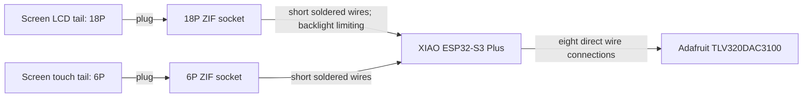

# DIY wiring: XIAO ESP32-S3 Plus, 2.8-inch capacitive screen and headphone DAC

Updated 2026-10-08. User confirmed XIAO ESP32-S3 Plus; its seller does not assemble custom adapters. Enclosure constraints are deferred. This guide is a proposed bench assembly, not tested hardware or an approved final AliExpress cart.

**Current choice:** user accepted eight **direct ESP-to-Adafruit wires**, and wants to solder by hand with no added PCB. The active list is [DIY_SHOPPING_LIST.md](DIY_SHOPPING_LIST.md). Directly wiring loose screen sockets is possible microsoldering work, but requires separate mechanical support, insulation and wire strain relief. No direct-socket construction has been designed/tested here. The screen still needs verified 18P/6P mating sockets and backlight limiting. Short 28 AWG stranded-copper two-core cable can serve power/ground or pairs of signals, but each pair only carries two independent nets.

## Practical assembly

Plug the screen's supplied tails into verified **18P/0.5 mm and 6P/0.5 mm ZIF sockets**. For the user's no-extra-PCB route, solder short insulated wires to the used socket contacts and XIAO pads, then mechanically support/insulate the sockets and strain-relieve the wires. Never solder directly onto the screen's flexible tails. Connect the DAC's eight nets directly to the XIAO. Follow the tables below; a loose socket does not eliminate backlight current limiting or reset/control wiring.

The **12P audio sockets, breakout boards and FFC are removed from the active list**. If fine-pitch socket soldering proves impractical, a tiny ready-made passive breakout PCB is an easier optional substitute: its socket is already soldered on and each contact is exposed at a larger pad. That is not a custom main PCB. The XIAO Plus has extra small underside pads between its normal edge connections; the proposed map uses them. Ordinary XIAO side headers or a generic XIAO expansion board do not automatically expose these extra pads.

Manufacturer examples of that optional accessory: [Crystalfontz passive 18P/0.5 mm ZIF breakout](https://www.crystalfontz.com/product/cfabbcs050z18ga0-18-position-zif-breakout-board), [Sunrom preassembled 6P board](https://www.sunrom.com/p/6p-pcb-with-05mm-ffc-connector-soldered). These are examples explaining the alternative hardware, not verified AliExpress purchases or confirmed mates for the selected screen.

## Parts to find on AliExpress

| Quantity | Part / search text | Required checks |
|---:|---|---|
| 1 | `18 pin 0.5mm FPC FFC ZIF socket` | Accepts screen's 0.30 ±0.03 mm reinforced end; contact face/insertion geometry must match the tail. Fine-pitch direct soldering/support required. |
| 1 | `6 pin 0.5mm FPC FFC ZIF socket` | Same checks, six contacts. |
| Approximately 2 m supply | 28 AWG two-core insulated stranded copper wire | Short flexible wire for power/ground or pairs of signals; two cores are only two nets. Actual gauge/length/load and insulation determine suitability. |
| Small spool, optional | 30 AWG individually insulated signal wire | Easier routing/soldering at fine contacts; short 28 AWG signal wires can also work. |
| 4 | 47 ohm resistors, 1/8 W or greater | Conservative fixed-brightness backlight starting point for regulated 3.3 V, subject to the selected screen's specification; see below. |
| Small pack | 10 kilohm resistors | Defined startup pulls if not already fitted: reset-low and LCD-CS-high. Check existing module resistors before adding. |
| As needed | Flux, fine solder, fine-tip iron, tweezers, magnifier, multimeter, thin polyimide insulation and mechanical support | The XIAO extra pads and 0.5 mm socket contacts need careful soldering. |

Full purchasing requirements and keep/remove decisions are in [DIY_SHOPPING_LIST.md](DIY_SHOPPING_LIST.md). AliExpress discovery searches for the easier optional route: [18P breakout](https://www.aliexpress.com/w/wholesale-18-pin-0.5mm-FPC-breakout-board.html), [6P breakout](https://www.aliexpress.com/w/wholesale-6-pin-0.5mm-FPC-breakout-board.html); not checked purchase links.

For an optional breakout, confirm it includes the socket soldered onto a PCB, not an empty board or loose socket. For either route, do not accidentally buy a 1.0 mm-pitch variant from a mixed listing. Prefer low-profile horizontal-entry geometry and verify contact dimensions. Complete assembly depth is not established here.

**Selected loose-socket evidence, 2026-10-08 01:58:** seller drawing supplied in `Screenshot 2026-10-08 at 1.58.42.png` for AliExpress item 1005004837108452 specifies 0.5 mm pitch, 0.30 mm applicable FPC thickness and 2.00 ±0.1 mm socket height. Keep its 18P and 6P options for the prototype: these match the screen's nominal tail specifications. This resolves the earlier missing thickness evidence; it does not replace checking actual contact engagement, ribbon face and pin 1 before wiring/power. No extra screen FFC is required.

The previous gray IDC cable is not a mate for these FPC sockets. Also, an 18P EYESPI or other display-specific adapter is not automatically suitable: some join contacts or route power according to another display's pinout. We need a passive individually exposed contact breakout or a supplier-confirmed adapter made for this exact screen.

## Connection map

Read **D labels** against the [Seeed Plus pinout](https://wiki.seeedstudio.com/xiao_esp32s3_getting_started/) and its [underside image](https://files.seeedstudio.com/wiki/SeeedStudio-XIAO-ESP32S3/img/XIAO_ESP32-S3_Plus_back_pinout.png). Firmware uses the GPIO column. Identify board orientation before soldering: an underside image is a bottom view, not a top view.

Screen assignment follows the user's YT280S030-DCT drawing and GT911 table. The [family datasheet](https://28392816.s21i.faiusr.com/61/ABUIABA9GAAgyb-ltgYogMf5owY.pdf) corroborates it but is an older ST7789V revision; the user's drawing names ST7789T3. The selected seller's exact revision and initialization code still need confirmation.

### LCD: 18P tail

| Screen contact | Signal | Connection |
|---:|---|---|
| 1, 8 | GND | Common GND |
| 2 | RESET | D3 / GPIO4 |
| 3 | SCL: SPI clock | D8 / GPIO7 |
| 4 | D/C | D0 / GPIO1 |
| 5 | CSX | D1 / GPIO2 |
| 6 | SDA: SPI write data | D10 / GPIO9 |
| 7 | SDO | Leave disconnected for write-only LCD operation |
| 9 | VDD | Regulated 3.3 V within the screen's limits |
| 10 | LED-A | Backlight supply; regulated 3.3 V for the resistor prototype below |
| 11–14 | LED-K1…K4 | Each through its own 47 ohm resistor to GND for initial fixed brightness |
| 15–18 | NC | Leave disconnected |

The LCD's SCL/SDA are **SPI**, unlike the touch's I2C SCL/SDA. Do not connect them to the same pair of ESP pins.

### Capacitive touch: 6P tail

| Touch contact | Signal | Connection |
|---:|---|---|
| 1 | GND | Common GND |
| 2 | RST | D7 / GPIO44 |
| 3 | INT | D17 / GPIO13, extra underside pad |
| 4 | I2C SDA | D4 / GPIO5 |
| 5 | I2C SCL | D5 / GPIO6 |
| 6 | VCC | Regulated 3.3 V |

GT911 INT is a signal, not power. Its reset/address sequence briefly drives INT before using it as an input; configure that sequence in firmware. Avoid putting INT on default boot UART TX GPIO43. [Espressif GT911 driver reference](https://github.com/espressif/esp-bsp/blob/master/components/lcd_touch/esp_lcd_touch_gt911/esp_lcd_touch_gt911.c).

### Adafruit TLV320DAC3100 #6309

| DAC pad | XIAO connection |
|---|---|
| VIN | Regulated 3.3 V for headphone use |
| GND | Common GND |
| BCK | D12 / GPIO39, extra underside pad |
| WSEL | D13 / GPIO40, extra underside pad |
| DIN | D11 / GPIO38, extra underside pad |
| SDA | D4 / GPIO5, shared with touch |
| SCL | D5 / GPIO6, shared with touch |
| RST | D14 / GPIO41, extra underside pad |

Leave MCK unused only with firmware configured to derive the DAC PLL clock from BCLK. Initialize/reset the DAC and enable its headphone signal path. Disable its speaker amplifier for headphone use. Connect headphones to the original jack. The board's two-pin JST speaker connector is not the ESP connection. See [Adafruit's pin descriptions](https://learn.adafruit.com/adafruit-tlv320dac3100-i2s-dac/pinouts).

Use the eight direct wires in the DAC table. Keep them short and route audio clocks close to a ground return. The previously proposed audio FFC conductor map is archived in [ELECTRONICS_CONNECTION_PLAN.md](ELECTRONICS_CONNECTION_PLAN.md); do not buy its audio parts for this direct-wire build.

### Reserve storage/control connections

**Current recommended SD model: Adafruit MicroSD SPI/SDIO breakout #4682 — 3V only**, identified in the user's `Screenshot 2026-10-08 at 1.43.34.png` by title and pictured board. Manufacturer [pinout](https://learn.adafruit.com/adafruit-microsd-spi-sdio/pinouts) confirms 3.3 V power/logic and SPI mode. Solder wires directly; do not install the tall supplied headers.

| #4682 pad | XIAO Plus connection |
|---|---|
| 3V | Regulated 3.3 V, never 5 V or battery voltage |
| GND | Common GND |
| CLK | D8 / GPIO7, SPI SCK |
| SI / CMD | D10 / GPIO9, SPI MOSI |
| SO / D0 | D9 / GPIO8, SPI MISO |
| CS / D3 | D18 / GPIO12, extra underside pad |

Leave SD board D1, DAT2 and DET unused initially. `CS/D3` is a label on the SD board; it connects to **XIAO D18**, not XIAO D3. Firmware must share SPI correctly with the LCD using separate CS lines. The SD board already has SPI pullups.

The earlier AliExpress modules with 4.5–5.5 V or contradictory generic power descriptions are superseded by the #4682 recommendation. Do not reuse their generic `GPIO19/23/18/5` example on XIAO ESP32-S3 Plus; GPIO19 is native USB and GPIO23 does not exist on ESP32-S3. The screenshot establishes the advertised #4682 model, not delivered seller authenticity or tested system operation.

Leave D2/GPIO3 unused in this plan (boot strap), D6/GPIO43 reserved, D16/GPIO10 for onboard battery sensing, and D19/GPIO11 spare. D15/GPIO42 is reserved for a future backlight driver PWM/enable input; do not attach LED current to it.

## Backlight and power

A passive adapter is not a backlight driver. The corroborating screen datasheet shows four parallel LEDs, nominal 15 mA each / 60 mA total, and approximately 3.0–3.3 V forward voltage at its stated operating current. It explicitly requires limiting.

For initial testing at regulated 3.3 V, connect LED-A to 3.3 V and **each cathode separately through 47 ohms to GND**. This deliberately starts with lower, fixed brightness. It is a conservative engineering starting point, not a manufacturer-qualified brightness setting or a validated LED current: forward voltage changes with current. Measure the actual branch currents and remain within the selected screen's limits. Do not feed the backlight from 5 V with these values. Later, brightness control needs an appropriate MOSFET/driver plus current limiting; D15 is a control signal only.

Power the initial prototype through the XIAO's USB-C. Verify the 3.3 V output is within the LCD/touch limits and can supply the combined load with margin. Do not connect the battery or 5 V directly to LCD VDD, touch VCC or digital signals. All modules need common ground. The [Plus V1.1 schematic](https://files.seeedstudio.com/wiki/SeeedStudio-XIAO-ESP32S3/res/XIAO_ESP32S3_Plus_V1.1_SCH_260115.pdf) specifies a regulator maximum that still needs load qualification with ESP radio, SD and audio active. Battery power/charging and USB/battery transitions remain separate work.

## Assembly and first checks

1. The selected socket drawing now matches nominal screen pitch/thickness. On receipt, check screen contact face, actual tail engagement and pin 1; label each used contact. Optional breakouts must expose every contact individually.
2. Solder short insulated wires to the XIAO, DAC and screen socket contacts (or optional breakout pads) with power disconnected. Keep roughly 1–5 cm where placement permits, minimize exposed conductor, inspect for solder bridges, and add strain relief away from the solder joints. Insulate/support sockets and boards; do not leave them hanging from the tails. Protect ribbon contact areas and latches from solder/adhesive.
3. Add current limiting and defined reset/CS startup states, accounting for onboard pulls. Verify power/ground and ribbon continuity before plugging in the modules.
4. With USB power, check the 3.3 V rail first. Bring up LCD image, touch I2C/reset/coordinates and DAC audio separately using drivers configured to the pin map. Shared I2C addresses are GT911 0x5D or 0x14 and DAC 0x18; Adafruit already fits SDA/SCL pullups.
5. Add SD and test simultaneous playback, touch interaction, cold starts and rail stability. Select final backlight control and qualify battery operation afterwards.

No physical assembly, current measurements or playback tests have been performed in this workspace. This guide makes the proposed DIY connections concrete; it does not certify perfect operation or verify an unchecked component listing.
